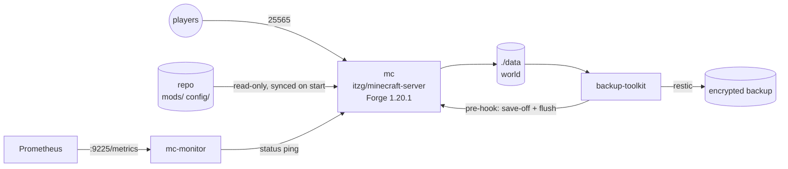

# minecraft-server-ops

A modded Minecraft server (Forge 1.20.1) run like production infrastructure:
everything in Docker Compose, consistent backups, metrics and alerts, and one CLI for daily operations.
It hosts a small private modpack server I play on with friends.



## Quick start

```bash
./scripts/mcctl setup        # .env + random RCON password
cp ~/my-modpack/*.jar mods/  # your mods
$EDITOR .env                 # whitelist, memory, MOTD
./scripts/mcctl up
./scripts/mcctl logs
```

## Daily operations

| Command | What it does |
|---|---|
| `mcctl status` | container health, online players, memory/CPU |
| `mcctl players` | who's online |
| `mcctl say "<text>"` | broadcast a message |
| `mcctl cmd "<command>"` | run any server command via RCON |
| `mcctl console` | interactive RCON console |
| `mcctl restart` | 60-second in-game countdown, save, restart |
| `mcctl update` | pull new image, countdown, recreate |
| `mcctl down` | flush world to disk, then stop |

## Backups

World backups use [backup-toolkit](https://github.com/businessantonybdc-crypto/backup-toolkit). Two hooks make them consistent:

```bash
sudo ln -s "$PWD/scripts/backup-hook-pre.sh"  /etc/backup-toolkit/hooks/pre.d/50-minecraft
sudo ln -s "$PWD/scripts/backup-hook-post.sh" /etc/backup-toolkit/hooks/post.d/50-minecraft
# and add "$PWD/data" to BACKUP_PATHS in /etc/backup-toolkit/backup.env
```

Before the snapshot the pre-hook runs `save-off` + `save-all flush`, so no region file is half-written;
the post-hook turns autosave back on, also when the backup failed.

## Monitoring

`mc-monitor` exposes `minecraft_status_healthy`, `minecraft_status_players_online_count` and
`minecraft_status_response_time_seconds` on port 9225. [homelab-monitoring](https://github.com/businessantonybdc-crypto/homelab-monitoring)
scrapes it and alerts on Discord if the server is down for more than 2 minutes.

## Windows

Runs unchanged on Docker Desktop (WSL 2), see [docs/windows.md](docs/windows.md).

## Design decisions

- **The repo is the modpack.** Mods and configs are mounted read-only and synced on start (`REMOVE_OLD_MODS`), so the server always matches git. Jar files are not committed for licensing reasons; `mods/mods.txt` lists them instead.
- **Secrets as files.** The RCON password is a Docker secret generated by `mcctl setup`, never in `.env` or the compose file.
- **Players first.** Restarts and updates warn players with an in-game countdown and flush the world before the container stops; `stop_grace_period` gives Forge time to shut down cleanly.
- **Bounded resources.** Java heap and container memory limit are separate settings, so a memory leak in a mod can't take the host down.

---

Part of my homelab series → [server-baseline](https://github.com/businessantonybdc-crypto/server-baseline) · [backup-toolkit](https://github.com/businessantonybdc-crypto/backup-toolkit) · [homelab-monitoring](https://github.com/businessantonybdc-crypto/homelab-monitoring)
